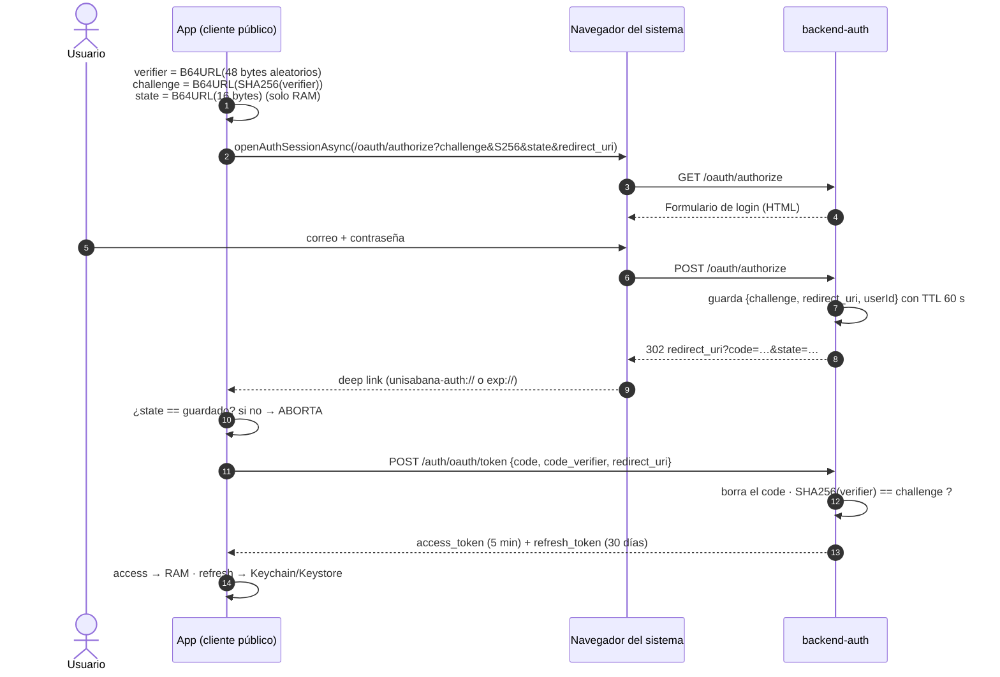
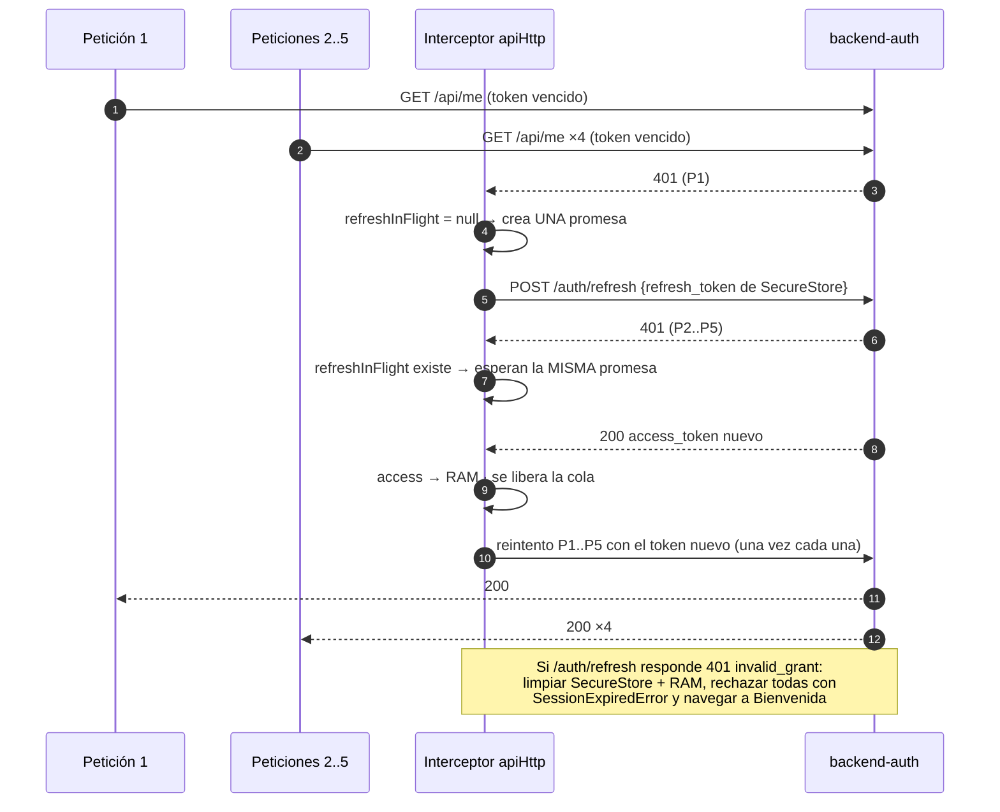
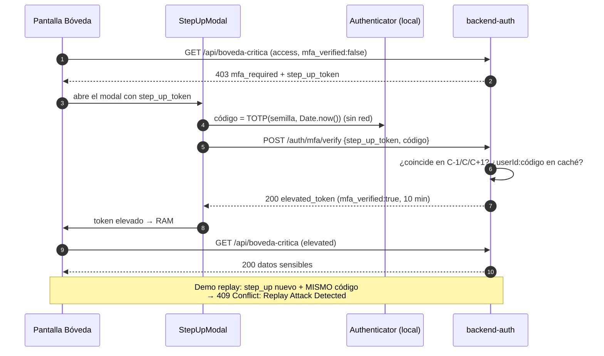

# Explicación del laboratorio — guía de estudio para la sustentación

Este documento explica **qué hace cada módulo, por qué está hecho así y dónde está el código**, con diagramas y preguntas probables. Las rutas son relativas a la raíz del repositorio.

---

## 0. Las ideas en una página

| Concepto | Una frase | Archivo clave |
|---|---|---|
| Cliente público | La app no puede guardar secretos (se descompila), así que no tiene `client_secret`. | `mobile-app/src/config/constants.ts` |
| PKCE | La app demuestra que **es la misma** que pidió el code, enviando un secreto de un solo uso (`code_verifier`) cuyo hash ya había enviado (`code_challenge`). | `mobile-app/src/lib/pkce/pkceCore.ts` |
| `state` | Valor aleatorio que la app guarda en memoria y exige de vuelta: impide que un atacante le "inyecte" su propio code (CSRF de login). | `mobile-app/src/auth/oauthFlow.ts` |
| Navegador del sistema | La contraseña se escribe en un navegador aislado de la app (Custom Tabs / ASWebAuthenticationSession), no en un WebView que la app podría espiar. | `mobile-app/src/auth/oauthFlow.ts` |
| Separación de tokens | access (5 min) en RAM; refresh (30 días) en Keychain/Keystore. | `mobile-app/src/auth/tokenStore.ts`, `mobile-app/src/storage/secureStorage.ts` |
| Silent refresh queue | Ante 401 se renueva **una sola vez** y todas las peticiones esperan esa misma promesa. | `mobile-app/src/api/createApiClients.ts` |
| TOTP | `HOTP(K, floor(t/30))`: HMAC-SHA1 + truncamiento dinámico → 6 dígitos. | `mobile-app/src/lib/totp/totpCore.ts` |
| Step-up | Un recurso crítico exige un token "elevado" que solo se obtiene con el 2.º factor. | `backend-auth/src/routes/api.ts`, `backend-auth/src/routes/session.ts` |
| Anti-replay | El servidor recuerda 90 s cada código aceptado y rechaza el reuso con 409. | `backend-auth/src/stores/replayCache.ts` |

---

## 1. Punto 1 — OAuth 2.0 + PKCE (RFC 7636)

### 1.1 Generación de PKCE y `state` (`mobile-app/src/lib/pkce/pkceCore.ts`)

1. `code_verifier` = Base64URL(48 bytes del CSPRNG del sistema, `expo-crypto.getRandomBytesAsync`) → **64 caracteres** en `[A-Za-z0-9-_]` (dentro del rango 43–128 y del alfabeto *unreserved*). Se valida con `^[A-Za-z0-9\-._~]{43,128}$`.
2. `code_challenge` = Base64URL **sin relleno** ( SHA-256 ( bytes ASCII del verifier ) ) → siempre **43 caracteres** (32 bytes).
3. `state` = Base64URL(16 bytes) → 22 caracteres, 128 bits de entropía.

Base64URL (`mobile-app/src/lib/crypto/base64url.ts`) y la conversión a bytes ASCII/UTF-8 (`mobile-app/src/lib/crypto/bytes.ts`) están escritas a mano: React Native no tiene `Buffer`. Cada 3 bytes (24 bits) se convierten en 4 caracteres de 6 bits; los restos de 1 o 2 bytes producen 2 o 3 caracteres, **sin `=`**.

El vector oficial del apéndice B (`dBjftJeZ…` → `E9Melhoa…`) se prueba en Node y también en el teléfono (Laboratorio → self-tests).

### 1.2 Navegador seguro y deep link (`mobile-app/src/auth/oauthFlow.ts`)

- `WebBrowser.openAuthSessionAsync(authUrl, redirectUri, { preferEphemeralSession: true })`:
  - iOS → `ASWebAuthenticationSession`: navegador del sistema aislado; la app no puede leer su contenido ni sus cookies.
  - Android → Chrome **Custom Tabs**: proceso del navegador, no de la app.
- `redirectUri = Linking.createURL('callback')` → `unisabana-auth://callback` (build) o `exp://IP:8081/--/callback` (Expo Go).
- La URL de autorización se arma con `encodeURIComponent` (`mobile-app/src/lib/oauth/authorizeRequest.ts`); no se usa `URL`/`URLSearchParams`, que en React Native son parciales.

### 1.3 Validación al volver

En este orden:
1. `result.type !== 'success'` → cancelado (sin error grave).
2. **`state` recibido ≠ `state` guardado (o ausente) → ABORTA** sin llamar a `/token`. La comparación no sale en el primer carácter distinto.
3. Si viene `error` → error del proveedor.
4. Sin `code` → callback inválido.
5. `POST /auth/oauth/token` con `{grant_type, code, code_verifier, client_id, redirect_uri}` usando `authHttp` (**sin interceptores**).

El `state` se borra de memoria nada más volver (de un solo uso), pase lo que pase.

### 1.4 Servidor (`backend-auth/src/routes/oauth.ts`, `backend-auth/src/oauth/authorizeParams.ts`)

- `GET /oauth/authorize` valida `client_id`, la allowlist de `redirect_uri`, `response_type=code`, `code_challenge_method=S256` (rechaza `plain`), un challenge de 43 caracteres y un `state` obligatorio. Muestra el formulario.
- `POST /oauth/authorize` **revalida** los campos ocultos (el formulario está en manos del navegador), comprueba credenciales, crea un code de 32 bytes (TTL 60 s) y responde **302** al `redirect_uri` con `code` y `state`, además de una página de respaldo con el botón "Volver a la app".
- `POST /auth/oauth/token` **consume (borra) el code primero** y luego valida: expiración, mismo `client_id` y `redirect_uri`, formato del verifier y `base64url(SHA256(verifier)) == challenge` con `timingSafeEqual`.



---

## 2. Punto 2 — Almacenamiento seguro y Silent Refresh Queue

### 2.1 Dónde vive cada cosa

| Dato | Lugar | Por qué |
|---|---|---|
| `access_token` (5 min) | Variable de módulo (`tokenStore.ts`) | Desaparece al matar el proceso; si se filtra, vale poco tiempo |
| `elevated_token` (10 min) | Variable de módulo | Igual; además no se renueva: hay que repetir el 2FA |
| `refresh_token` (30 días) | `expo-secure-store` | Cifrado por el sistema: Keychain (`kSecClassGenericPassword`) en iOS y un valor cifrado con una clave AES del **Android Keystore** en Android |
| Semilla TOTP | `expo-secure-store` | Es el segundo factor: nunca en texto plano |
| `state`, `code_verifier`, último código usado | Variables locales/de módulo | Solo durante el flujo |

Opción `keychainAccessible: WHEN_UNLOCKED_THIS_DEVICE_ONLY`: solo legible con el teléfono desbloqueado y excluido de copias de seguridad o migraciones. La app **no** tiene `AsyncStorage` instalado.

### 2.2 La cola (`mobile-app/src/api/createApiClients.ts`)

- `authHttp`: sin interceptores → `/auth/oauth/token`, `/auth/refresh`, `/auth/mfa/verify`, `/auth/logout`.
- `apiHttp`:
  - **Request**: si hay un refresh en curso, la petición **se pausa** hasta que termine; luego agrega `Authorization: Bearer <access en RAM>` y anota con qué token salió (`_sentToken`).
  - **Response**:
    - 403 `mfa_required` → `MfaRequiredError(step_up_token)` (no se refresca: no es un problema de sesión).
    - 401 con token elevado → `ElevationExpiredError` (se vuelve a pedir el 2FA).
    - 401 normal y sin `_retry` → marca `_retry`; si otra petición ya renovó el token, reintenta directamente; si no, espera `refreshAccessToken()`.
- `refreshAccessToken()`: si ya existe `refreshInFlight`, **devuelve la misma promesa** (eso es la cola). Si no, crea una:
  - OK → guarda el access nuevo en RAM y todas las esperas se resuelven → cada petición se reintenta **una vez**.
  - 400/401 `invalid_grant` → borra SecureStore y la memoria, rechaza todas con `SessionExpiredError` y emite `sessionExpired` → el `AuthProvider` cambia a `signedOut` → `Stack.Protected` lleva a Bienvenida con un aviso.
  - Sin red → `NetworkError`, **se conserva** el refresh_token.



### 2.3 Arranque en frío (`mobile-app/src/auth/AuthProvider.tsx`)

Como el access_token vivía en RAM, al abrir la app no existe. Con el splash visible: si hay refresh_token → silent refresh → `signedIn`. Rechazado → `signedOut` con aviso. Sin red → `signedIn` en modo sin conexión (el Authenticator funciona igual).

---

## 3. Punto 3 — TOTP desde cero (RFC 6238 / RFC 4226)

### 3.1 Base32 (`mobile-app/src/lib/totp/base32.ts`)

Alfabeto `A–Z2–7`: cada carácter son 5 bits. Se acumulan bits y cada vez que hay 8 sale un byte. `JBSWY3DPEHPK3PXP` → `48 65 6c 6c 6f 21 de ad be ef` ("Hello!" + DEADBEEF). Se normalizan espacios, guiones, minúsculas y `=`; mínimo 16 caracteres.

### 3.2 HMAC-SHA1 a mano (`mobile-app/src/lib/crypto/hmac.ts`, RFC 2104)

```
K' = K si |K| ≤ 64, si no SHA1(K); rellenar con ceros hasta 64 bytes
HMAC(K, m) = SHA1( (K' ⊕ 0x5c…) ‖ SHA1( (K' ⊕ 0x36…) ‖ m ) )
```
SHA-1 lo da `expo-crypto` (nativo) y se **inyecta** como función, así el mismo código se prueba en Node. Verificado con RFC 2202 caso 1 (`b617318655057264e28bc0b6fb378c8ef146be00`) y caso 6 (clave de 80 bytes).

### 3.3 Algoritmo (`mobile-app/src/lib/totp/totpCore.ts`)

1. `T = floor(unix / 30)`.
2. T en **8 bytes big-endian**: `DataView.setUint32(0, floor(T / 2³²))` y `setUint32(4, T mod 2³²)`. Los operadores de bits de JS truncan a 32 bits; por eso se divide aritméticamente.
3. `H = HMAC-SHA1(K, T)` → 20 bytes.
4. `offset = H[19] & 0x0F` (0–15).
5. `bin = ((H[o] & 0x7F) << 24) | (H[o+1] << 16) | (H[o+2] << 8) | H[o+3]` → 31 bits, siempre positivo.
6. `código = bin % 1 000 000`, con ceros a la izquierda (`054231`).

### 3.4 UI sin parpadeo y offline (`mobile-app/src/authenticator/useTotpCode.ts`)

- Recalcula solo al cambiar T; un `setTimeout` apunta al límite exacto de la ventana.
- **Precalcula T+1**: en el límite el código ya está listo.
- Nunca deja la pantalla vacía: mantiene el código anterior hasta tener el nuevo; nunca muestra "------".
- La barra (`mobile-app/src/components/CountdownBar.tsx`) se anima con `Animated.timing` y `useNativeDriver` (`scaleX`), sincronizada con `Date.now()`; se pone roja en los últimos 5 s.
- `AppState` → al volver a primer plano se resincroniza (los timers se congelan en segundo plano).
- Cero red: ni la pantalla ni el cálculo hacen peticiones.

### 3.5 Ingesta

- **QR** (`mobile-app/src/app/(app)/scan.tsx`): `CameraView` con `barcodeTypes: ['qr']`; una bandera `useRef` procesa una sola lectura. Parser propio de `otpauth://` (`mobile-app/src/lib/totp/otpauth.ts`): decodifica la etiqueta `Issuer:cuenta`, toma el `issuer` del parámetro o del prefijo y rechaza `algorithm≠SHA1`, `digits≠6` y `period≠30`.
- **Manual** (`mobile-app/src/components/ManualSecretForm.tsx`): validación en vivo con mensajes específicos.

---

## 4. Punto 4 — Step-up y anti-replay

### 4.1 Backend

- `GET /api/boveda-critica`: token `access` (`mfa_verified:false`) → **403** `{error:"mfa_required", step_up_token}` (JWT `typ: step_up`, 5 min). Token `elevated` (`mfa_verified:true`) vigente → **200**. Sin token / inválido / `step_up` → 401.
- `POST /auth/mfa/verify` (`backend-auth/src/routes/session.ts`), en orden:
  1. `step_up_token` válido y de tipo `step_up` (si no, 401).
  2. Límite de intentos: 5 fallos/min → 429.
  3. Formato `^\d{6}$` (si no, 400 `invalid_format`).
  4. TOTP en **C-1, C y C+1**, comparando las tres en tiempo constante (si ninguna, 400 `invalid_code`).
  5. **Caché anti-replay** `userId:código`: si existe → **409** `Replay Attack Detected`; si no, se guarda 90 s.
  6. Emite `elevated_token` (`mfa_verified:true`, 10 min).

### 4.2 App

La **pantalla** Bóveda (no el interceptor) captura `MfaRequiredError` y abre `StepUpModal` (teclado numérico, `oneTimeCode`, botón para autocompletar con el Authenticator integrado y mensajes por código de estado). Tras el éxito, el token elevado queda **solo en RAM** con su vencimiento y la bóveda se recarga sola. El refresh normal **no** hereda la elevación (`mfa_verified:false`).



---

## 5. Cómo se verificó

- **Backend** (`npm test`): 43 pruebas, entre ellas todos los vectores de los RFC, los flujos de error y 403 → 200 → 409. `npm run smoke` recorre el flujo completo contra el servidor real.
- **App** (`npm test`): 29 pruebas. El núcleo criptográfico es el mismo que corre en el teléfono; la cola de refresh se prueba **contra el backend real**: 5 peticiones concurrentes producen exactamente un `POST /auth/refresh`.
- **Paridad cruzada**: un test compara el TOTP de la app (HMAC a mano) con el del backend (`createHmac`) durante 20 ventanas.
- **Bundle**: `expo export` para Android compila; en el bundle no aparecen `client_secret`, `AsyncStorage`, `otplib` ni secretos del backend.

---

## 6. Preguntas probables de sustentación

1. **¿Por qué PKCE y no un `client_secret`?** — Una app móvil es un cliente público: cualquier secreto incluido en el APK/IPA se extrae con ingeniería inversa. PKCE crea un secreto **nuevo en cada login** (`code_verifier`) que nunca sale del teléfono hasta el canje; quien intercepte el `code` (otra app con el mismo esquema, un log) no puede canjearlo sin el verifier.

2. **¿Por qué S256 y no `plain`?** — Con `plain` el challenge **es** el verifier: quien vea la URL de autorización ya tiene el secreto. Con S256 solo viaja el hash, y SHA-256 no se puede invertir. El backend rechaza `plain`.

3. **¿Para qué sirve el `state` si ya hay PKCE?** — Protege a la **app** de un CSRF de login: un atacante podría hacer que la app recibiera un deep link con *su* code y la víctima terminaría dentro de la cuenta del atacante. Como el `state` es aleatorio, de un solo uso y solo existe en la memoria de la app, un deep link que no lo trae se rechaza antes del canje.

4. **¿Por qué el navegador del sistema y no un WebView?** — Desde un WebView la app puede inyectar JavaScript y leer la contraseña, y el usuario no ve la URL real (phishing). El navegador del sistema es un proceso aislado con barra de URL visible, y la contraseña nunca pasa por la app. Además es lo que exige la RFC 8252 (OAuth para apps nativas).

5. **¿Por qué el `refresh_token` no va en AsyncStorage?** — AsyncStorage es texto plano en el sandbox de la app (SQLite/archivos): se lee con un respaldo, root/jailbreak o malware. Un refresh token dura 30 días, así que su robo equivale a robar la sesión. SecureStore lo cifra con claves del Keychain/Keystore, que el sistema protege (y que pueden estar respaldadas por hardware).

6. **¿Y por qué el `access_token` NO va en SecureStore?** — Porque no hace falta persistirlo: dura 5 minutos y se recupera con el refresh. Tenerlo solo en RAM reduce la superficie: al matar la app desaparece.

7. **¿Qué pasa con 5 peticiones concurrentes que reciben 401?** — La primera crea **una** promesa de refresh; las otras cuatro reciben esa misma promesa y esperan. Cuando se resuelve, cada una se reintenta una vez con el token nuevo. Resultado: un `POST /auth/refresh`, cinco 200. Sin cola habría cinco refresh simultáneos (y con rotación de refresh tokens se invalidarían entre sí y cerrarían la sesión).

8. **¿Qué pasa si el refresh token también venció?** — `/auth/refresh` responde 401 `invalid_grant`: la app borra SecureStore y la memoria, rechaza todas las peticiones encoladas con `SessionExpiredError` y avisa al `AuthProvider`, que navega a Bienvenida con "Tu sesión expiró". Si el fallo es **de red**, no se cierra sesión.

9. **¿Por qué T va en big-endian de 8 bytes?** — Así lo define RFC 4226: el contador es un entero de 64 bits en orden de red (byte más significativo primero). Si se usaran 4 bytes o little-endian, el HMAC sería otro y el código no coincidiría con Google Authenticator. En JS se divide en dos mitades de 32 bits porque `<<`/`|` truncan a 32 bits.

10. **¿Qué hace exactamente el truncamiento dinámico?** — Toma los 4 bits bajos del último byte del HMAC como posición (`offset`, 0–15), lee 4 bytes desde ahí, apaga el bit más alto (`& 0x7F`, para que el número sea positivo en cualquier lenguaje) y aplica `% 10⁶`. Como el offset depende del propio hash, no siempre se usan los mismos bytes.

11. **¿Por qué se aceptan las ventanas C-1 y C+1?** — Por desfase de reloj entre teléfono y servidor, y por la latencia (el usuario puede escribir el código justo cuando cambia). Tolerar ±1 ventana (±30 s) es lo recomendado por RFC 6238 §5.2; más ventanas aumentarían la probabilidad de adivinar un código.

12. **¿Cómo evita el replay?** — Un código TOTP es válido hasta ~90 s (3 ventanas). Si alguien lo captura (hombro, malware, proxy), podría reusarlo. El servidor guarda cada código **aceptado** con la clave `userId:código` durante 90 s; un segundo intento responde **409**. El caché se consulta después de verificar el código, para que códigos inventados no ocupen memoria.

13. **¿Por qué un código incorrecto devuelve 400 y no 401?** — 401 significa "tu token de sesión no vale", y el interceptor reaccionaría intentando un refresh. Un código mal escrito no tiene nada que ver con la sesión.

14. **¿Qué impide usar el `step_up_token` para entrar a la bóveda?** — El claim `typ`: la API solo acepta `access` o `elevated`, y la bóveda exige `elevated` con `mfa_verified: true`. Además todos los JWT van firmados con HMAC-SHA256; cambiar un claim invalida la firma, y el algoritmo está fijado (se rechaza `alg: none`).

15. **¿Funciona en Modo Avión?** — Sí: el cálculo usa `Date.now()` y el SHA-1 nativo de `expo-crypto`, sin ninguna petición. Lo único que necesita es que la hora del teléfono sea correcta.

16. **¿Vieron alguna vez actuar la protección del `state`?** — Sí, en las pruebas reales. En Android, la librería abría Chrome a través de una actividad "proxy" que dejaba viva la pestaña del login anterior. En el segundo login, Android mostró esa pestaña vieja, con el `state` del intento anterior escondido en el formulario, en lugar de cargar la página nueva (el servidor ni siquiera registró el `GET /oauth/authorize`). El deep link volvió con un `state` que no era el del intento en curso, y la app **abortó sin canjear el code**: "el parámetro state no coincide (posible ataque CSRF)". Es exactamente lo que debe pasar ante un retorno que no corresponde a la solicitud. La corrección fue abrir el navegador sin ese proxy (`useProxyActivity: false`), para que cada login cargue una página nueva con su propio `state` y `code_challenge`. Aunque el `state` hubiera coincidido, PKCE también lo habría bloqueado: el code habría quedado ligado al `code_challenge` viejo.
